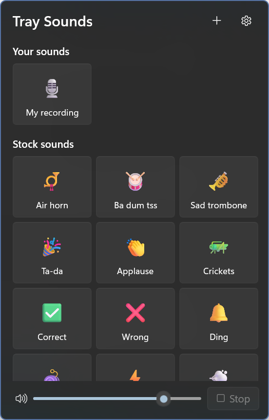
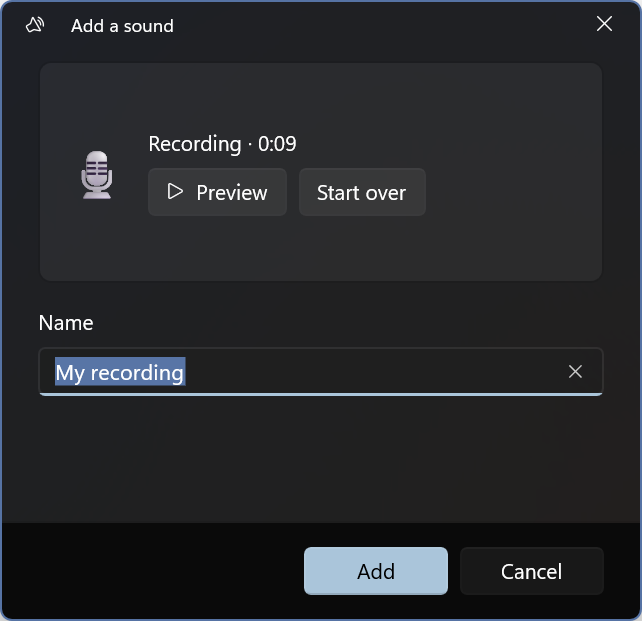

# Tray Sounds



A soundboard in the Windows notification area. Click the tray icon, click a tile, hear the sound.

Tray Sounds is a WinUI 3 app with no main window. The tray icon opens a small, always-on-top flyout next to the icon with a grid of sound tiles: fifteen stock sounds, plus any you record or add yourself. Sounds keep playing after the flyout closes.

## Features

- **Stock sounds:** air horn, ba dum tss, sad trumpet, ta-da, fanfare, grand entrance, applause, aww, crickets, boing, whoosh, plus a few synthesized by `scripts/GenerateStockSounds.cs` (correct, wrong, ding, pew). The downloaded ones are royalty-free and credited in `Assets/Sounds/sound attribution.csv`; hover a tile to see who made it, and right-click it to visit the creator's page or the sound's page.
- **Record your own:** record from the default microphone (up to one minute), preview it, give it a name, and add it to the board.
- **Use your own files:** pick or drag in a `.wav`, `.mp3`, `.m4a`, `.aac`, `.wma`, `.flac`, `.ogg`, or `.opus` file (up to 50 MB). The app keeps its own copy, so the sound still works after you move or delete the original.
- **Tiles:** click to play, and click again to stop. A playing tile shows a progress bar. Right-click a sound for its credit links; on your own sounds you can also **Edit** it (the same window used to add a sound: rename it, pick an emoji, and drag the range selector over the waveform to trim where playback starts and stops; the original file is never changed), show it in File Explorer, or delete it.
- **Volume and stop:** a volume slider and a Stop button sit at the bottom of the flyout. Volume changes apply to sounds that are already playing.
- **Tray menu:** right-click the icon for Open, a **Play** submenu with every sound (no flyout needed), Stop all sounds (while something plays), Add a sound, Settings, and Exit.
- **Tooltip:** hovering the icon shows what's playing.
- **Settings** (inside the flyout): One sound at a time (on by default; turn it off to layer sounds), Start with Windows, and a button that opens your sounds folder.
- **Theme-aware tray icon:** a dark glyph on a light taskbar and a white one on a dark taskbar, switching live. The flyout's acrylic follows the taskbar theme, like the shell's own flyouts.
- **Single instance:** launching the app again opens the running instance's flyout.



## Install

Requires Windows 10 1809 (build 17763) or later, x64 or ARM64.

Releases are published as signed MSIX packages on the GitHub releases page. If you sideload a release, install its signing certificate first (see the release notes).

## Privacy and footprint

- **No network access.** The package doesn't declare the `internetClient` capability.
- **Microphone:** used only while the Add a sound window is recording. Windows asks for permission the first time. If access is off, the window links to Settings > Privacy & security > Microphone.
- **Storage:** your sounds are copied to the package's `LocalState\Sounds` folder, and their names are kept in `LocalState\library.json`. Recordings in progress go to `TempState` and are deleted if you cancel. Settings (volume, playback mode) live in `LocalSettings`. Uninstalling the app removes all of it.
- **Idle cost:** with nothing open and nothing playing, the app is just the tray icon. Each sound gets its own media player, which is disposed when the sound ends. The flyout closes for real after a minute hidden, and its memory is returned.

## Build from source

Prerequisites: the [.NET 10 SDK](https://dotnet.microsoft.com/download), the winapp CLI (`winget install Microsoft.WinAppCli`), and Developer Mode turned on.

```powershell
winapp run            # build, register with package identity, and launch
winapp run --clean    # same, starting from a clean LocalState (first-run behavior)
dotnet test TraySounds.Tests
```

The first launch opens the flyout. After that the app runs from the tray. Look in the taskbar overflow (^) if the icon is hidden.

To regenerate the stock sounds after editing the synthesizer:

```powershell
dotnet run --file scripts\GenerateStockSounds.cs
```

To build signed x64 and ARM64 MSIX packages and a draft GitHub release, run `build-msix-for-gh.ps1`.

## Project layout

| Path | What it holds |
|---|---|
| `App.xaml.cs` | Tray icon, context menu (including the Play submenu), single instance, tooltip, exit |
| `Views/TrayFlyoutWindow` | The borderless flyout: placement, light dismiss, animation, idle close, settings page swap |
| `Views/FlyoutPage` | The soundboard grid, volume, and Stop |
| `Views/SettingsPage` | Settings shown inside the flyout |
| `Views/AddSoundWindow` | Record, pick, or drop a sound, preview it, and name it |
| `Services/PlaybackService` | One `MediaPlayer` per playing sound, independent of any window |
| `Services/SoundLibrary` | Stock sound list, plus the user's sounds in LocalState |
| `Services/AudioRecorder` | Microphone capture to `.m4a` via `MediaCapture` |
| `Services/SoundNamePolicy` | Pure naming and file rules, covered by `TraySounds.Tests` |
| `scripts/GenerateStockSounds.cs` | C# file-based app that synthesizes the generated stock `Assets/Sounds/*.wav` |

## License

MIT, see [LICENSE](LICENSE).
